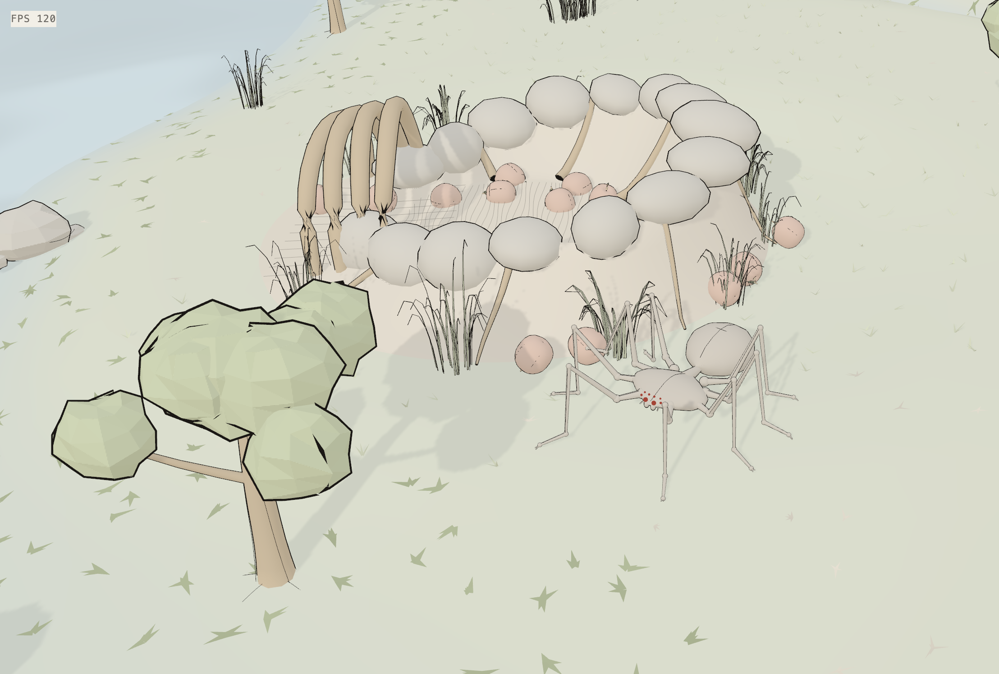
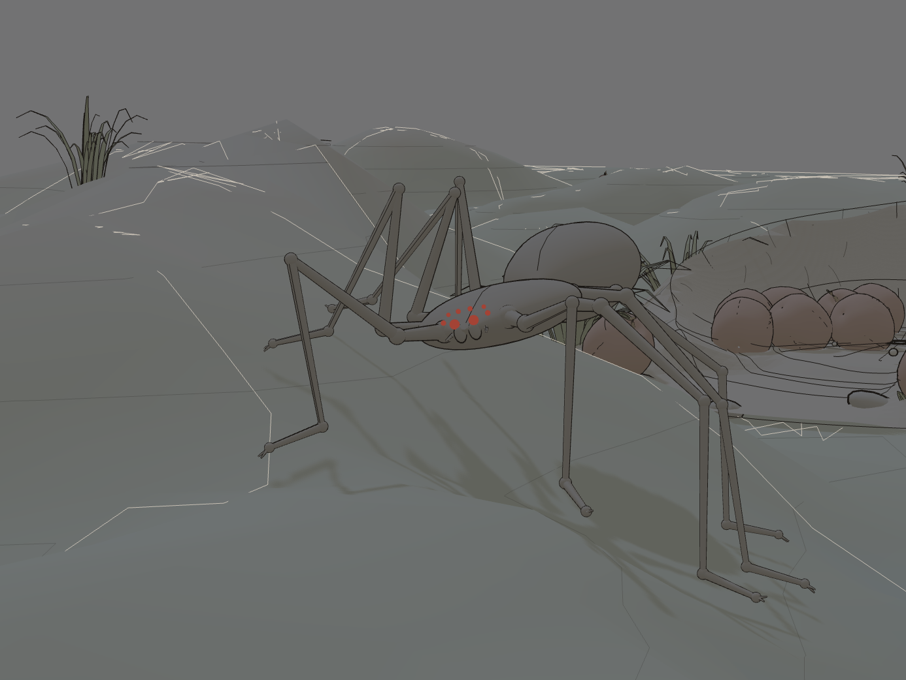

<p align="center">
  
</p>

<h1 align="center">蛛小八</h1>

<p align="center">
  住在蛛岛上的 3D 蜘蛛宠物，用自然语言与它互动。
</p>

<p align="center">
  <a href="https://spider.minorcell.top/"><strong>在线体验 ↗</strong></a>
  &nbsp; · &nbsp;
  <a href="#接入模型">接入模型</a>
  &nbsp; · &nbsp;
  <a href="#实现原理">实现原理</a>
  &nbsp; · &nbsp;
  <a href="#本地开发">本地开发</a>
</p>

<p align="center">
  <a href="https://codecov.io/gh/minorcell/spider"></a>
</p>

蛛小八是一只住在蛛岛上的 3D 蜘蛛宠物，运行在浏览器中。接入语言模型后，你可以让它探索岛屿、寻找食物，或把物品搬回巢穴。模型根据蜘蛛感知到的环境选择行动，你可以在画面中观察它如何完成任务。

<p align="center">
  <a href="./docs/images/spider-nest.webp"></a>
  <a href="./docs/images/night-action.webp"></a>
  <br />
  <sub>游戏实景 · 白天的巢穴 / 夜间活动 · 点击图片查看大图</sub>
</p>

## 从一句话开始

蛛岛上有草地、山坡和水域，也有可以交互的食物与物品。蜘蛛需要走到目标附近才能吃东西、搬运物品或喝水；遇到障碍和陡坡时，需要绕行或调整身体高度。夜晚的视野会缩短，它也可以打开背上的灯。

接入模型后，在页面底部输入一句话，按回车发送。可以试试这些指令，实际行动取决于模型的选择和当时的环境。

- “找一个苹果，搬回巢里。”
- “去水边喝点水，把那里记作水边。”
- “回到巢里睡一觉。”

行动时，蜘蛛身边会显示它正在做什么。再次发送指令会打断当前任务。它还可以记录有名字的地点，之后再按名字返回，例如先让它记住“水边”，再让它“回水边”。

## 接入模型

在线体验无需安装项目，但需要自行接入语言模型。可以使用本机运行的 Ollama，也可以使用提供 OpenAI 兼容接口的模型服务。在线服务的 API Key 需要向对应服务商获取，调用费用由服务商按其规则收取。

打开右上角的「设置」，进入模型页面。底部提供 Ollama 和 DeepSeek 的快速接入入口，也可以手动填写以下字段。

| 字段     | 填写内容                                                                          |
| -------- | --------------------------------------------------------------------------------- |
| Base URL | 模型服务的 API 基础地址，通常以 `/v1` 结尾，不要填完整的 `/chat/completions` 地址 |
| Model ID | 服务商提供的模型标识，或 Ollama 中已下载的模型名                                  |
| API Key  | 对应服务的访问密钥；使用 Ollama 快速接入时无需填写                                |

选择 Ollama 后，页面会尝试列出本机模型，点击模型名即可填入。选择 DeepSeek 后，页面会填入预设地址和模型名，再填写 API Key；也可以按服务商实际提供的模型修改 Model ID。

模型需要能够根据指令调用工具，所用接口也需要允许浏览器跨域请求。接入表现会受模型和接口兼容性影响。「思考」默认开启，使用模型默认的推理设置；关闭后会请求跳过推理，部分模型或接口可能不支持。

Ollama 的安装、跨域配置和常见连接问题见[模型接入说明](docs/model-setup.md)。

## 进度与数据

世界进度默认保存在当前浏览器中，包括蜘蛛的位置、携带的物品、已标记的地点和待完成的指令。刷新或重新打开页面后会尝试恢复；清除站点数据会移除本地存档。日记用于保留对话摘要和蜘蛛记下的内容。

模型设置和 API Key 保存在当前浏览器中。调用模型时，浏览器直接向你配置的模型服务发送请求，内容包括对话、相关的环境信息和工具结果，API Key 随请求用于认证。

如需跨设备继续，可以在设置的「云端」中连接自己的 S3 兼容对象存储，同步世界和日记。模型设置、模型密钥、用量记录和对象存储密钥不包含在云端存档中；对象存储密钥用于向所配置的存储服务签名请求。配置要求、冲突处理和保存机制见[存档与同步](docs/storage.md)。

## 实现原理

蜘蛛的行动由语言模型和本地模拟程序共同完成。模型收到用户指令后，可以调用工具观察附近的对象、移动、操作物品或记录地点。程序执行这些动作，再把结果交回模型，供它决定下一步。

例如收到“把苹果搬回巢里”后，模型可以先观察，找到苹果后走近并搬起，再返回巢穴存放。如果路被挡住，程序会返回失败原因和可用的行动提示，模型可以据此重试。模型接收的是结构化的环境信息，感知范围受距离、遮挡和光照限制。

蛛小八的默认性格是好奇、亲近人，做成小事会有一点得意。人格提示词约定它的表达方式和行动偏好，环境事实与行动结果仍由模拟程序提供。人格设定和工具规则见[系统提示词](src/client/agent/prompt.ts)。

这里的 Agent 指这个能够观察、选择并执行行动的循环。Agent harness 是支持它运行的程序，包括环境描述、工具、执行反馈、对话与记忆管理。移动、碰撞、寻路和物品交互由模拟程序处理，Three.js 负责把世界呈现在浏览器中。

想了解具体实现，可以从这些文件开始阅读。

| 关注的问题                                 | 代码入口                               |
| ------------------------------------------ | -------------------------------------- |
| 如何把用户指令交给模型，接收并执行工具调用 | [Agent 循环](src/client/agent/loop.ts) |
| 蜘蛛能调用哪些工具，行动失败时得到什么反馈 | [工具定义](src/client/agent/tools.ts)  |
| 移动、观察和物品交互如何执行               | [模拟会话](src/shared/sim/session.ts)  |
| 模型能感知到哪些状态                       | [状态与观察类型](src/shared/state.ts)  |
| 对话、日记与摘要如何组织                   | [日记与记忆](src/client/journal/)      |

## 本地开发

需要 Node.js 24 或更新版本，以及 pnpm。CI 使用 pnpm 11。

```bash
pnpm install
pnpm dev
```

在浏览器中打开终端输出的地址，再按上面的步骤接入模型。

| 命令                | 用途                           |
| ------------------- | ------------------------------ |
| `pnpm build`        | 构建生产版本                   |
| `pnpm preview`      | 在本地预览生产构建             |
| `pnpm typecheck`    | 检查客户端 TypeScript 类型     |
| `pnpm lint`         | 检查代码规范                   |
| `pnpm format:check` | 检查文件格式                   |
| `pnpm test`         | 运行测试，包含本地性能预算测试 |
| `pnpm bench`        | 运行性能基准，输出耗时和吞吐量 |

性能预算受机器负载影响，仅在本地运行；CI 会排除这组测试。后台线程的分工、各组基准覆盖的路径，以及如何理解测量结果，见[性能与基准测试](docs/performance.md)。
